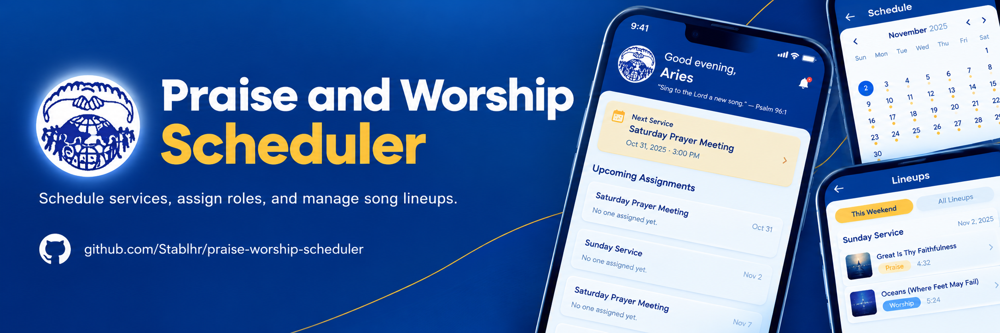

# 🎵 UCJM Praise & Worship Ministry App

## 📖 Project Overview

A mobile app for the praise and worship ministry team of **Unity in Christ Jesus Ministries (UCJM)**.
Every week the team needs to know who is assigned to which role, which songs are in the lineup, and
when the next service is — all in one place. The app also reminds everyone 2–3 days before each
service.

The app is built as a **Next.js 16** web app (mobile-first at 390 px) with an **Express.js** API
alongside it, wrapped with **Capacitor** for Android and iPhone from a single codebase. All data
lives in **MongoDB**, and authentication uses **email and password** with JWT tokens in HTTP-only
cookies.

### Key Features

- **Splash & Login** — Church logo, "UCJM" title, sign-in and open sign-up (anyone in the ministry
  can create an account and choose their position).
- **Home (Dashboard)** — Greeting by time of day, Next Service card, upcoming assignments, and
  this week's team photo.
- **Schedule** — Monthly calendar with service dots, service details with role assignments,
  admin tools to add/edit/remove services and generate the next 8 weeks.
- **Lineups** — This Weekend and All Lineups tabs; unlimited songs per service with
  Praise/Fast and Worship/Slow tags, links, and reorder. Editable by song leaders and admins.
- **Members** — Search, filter by role, add/edit/remove members (admin only).
- **Notifications** — In-app notifications with unread badge; daily reminder job 3 and 2 days
  before each service; triggers on lineup and assignment changes.
- **Settings** — Profile editing, appearance (Light/Dark/System), language, notifications toggle,
  and admin system settings (service times, reminder timing).
- **Photo Paste** — Paste a photo from the clipboard onto a service; compresses on the client
  before upload. Gallery picker fallback for phones.

## 🛠️ Tech Stack

### Frontend

| Layer | Technology |
|-------|------------|
| Framework | Next.js 16 (App Router) |
| UI library | React 19 |
| Language | TypeScript 5 |
| Build tool | Turbopack / Next build |
| Styling | Tailwind CSS v4 + shadcn/ui |
| Icons | Lucide React |
| Server state | TanStack Query v5 |
| HTTP | Axios |
| Linter | ESLint |

### Backend

| Layer | Technology |
|-------|------------|
| Framework | Express.js |
| Database | MongoDB via Mongoose |
| Auth | jsonwebtoken, HTTP-only cookie rotation, bcrypt |
| Validation | Zod (DTO pattern) |
| Email | Nodemailer |
| Uploads | multer (disk storage) |
| Logging | Pino |
| Security | Helmet, CORS, express-rate-limit, input sanitization |
| Scheduler | node-cron (daily reminder job) |

### Mobile (Phase 8)

| Layer | Technology |
|-------|------------|
| Wrapper | Capacitor (Android + iOS from one codebase) |

## 📁 Project Structure

```
paw/
├── frontend/
│   ├── app/
│   │   ├── (app)/
│   │   │   ├── splash/            # Splash screen (logo, title, tagline)
│   │   │   ├── login/             # Sign-in and sign-up
│   │   │   └── (shell)/           # Protected shell (bottom nav)
│   │   │       ├── home/          # Dashboard
│   │   │       ├── schedule/      # Calendar + service details
│   │   │       ├── lineups/       # Song lineups per service
│   │   │       ├── members/       # Team members
│   │   │       ├── notifications/ # In-app notifications
│   │   │       ├── settings/      # Profile, theme, system settings
│   │   │       └── more/          # More tab (notifications, settings, logout)
│   │   ├── globals.css            # Tailwind entry + design tokens
│   │   └── layout.tsx             # Root layout, metadata, fonts
│   ├── components/
│   │   ├── app/                   # App UI (BrandLogo, TopBar, BottomNav, etc.)
│   │   └── ui/                    # shadcn/ui primitives
│   ├── lib/
│   │   ├── api/                   # Axios client, auth/members/services/lineups/notifications/settings APIs
│   │   ├── auth/                  # Permission helpers (isAdmin, isSongLeader)
│   │   ├── hooks/                 # React Query hooks
│   │   ├── image/                 # Image compression
│   │   ├── schedule/              # Calendar helpers
│   │   └── provider/              # ReactQueryProvider
│   ├── public/assets/             # Static assets & church logo
│   └── .env.example
└── backend/
    ├── api/
    │   ├── config/                # DB connection, env validation
    │   ├── constants/             # Error codes, service roles
    │   ├── controllers/           # Route handlers
    │   ├── dtos/                  # Zod validation schemas
    │   ├── logging/               # Pino logger
    │   ├── middleware/            # Auth, validation, rate limit, sanitize, upload
    │   ├── models/                # Member, Service, Assignment, Lineup, Notification, Settings
    │   ├── repositories/          # Data access layer
    │   ├── routes/                # Express router definitions
    │   ├── services/              # Business logic
    │   ├── templates/             # HTML email templates
    │   └── utils/                 # Error, manila (timezone), manila dates
    ├── scripts/
    │   └── seed-admin.ts          # Admin seed script
    ├── uploads/                   # Uploaded photos (git-ignored)
    ├── .env.example
    └── package.json
```

## ⚙️ Prerequisites

- Node.js 18+
- npm
- Git
- MongoDB instance (local or Atlas)
- SMTP credentials (e.g. Gmail, Resend, Mailtrap)

## 🚀 Getting Started

### 1. Clone the repository

```bash
git clone https://github.com/your-org/ucjm-praise-worship.git
cd ucjm-praise-worship
```

### 2. Set up the Backend

```bash
cd backend
npm install
cp .env.example .env
```

Fill in `MONGO_URI`, `JWT_SECRET`, `JWT_REFRESH_SECRET`, the SMTP values, and
`ADMIN_EMAILS` — see `backend/.env.example` for the full list.
Generate secrets with:

```bash
node -e "console.log(require('crypto').randomBytes(64).toString('hex'))"
```

Then seed an admin account and start the server:

```bash
npm run seed:admin
npm run dev
```

The API runs at `http://localhost:5000`.

### 3. Set up the Frontend

Open a new terminal:

```bash
cd frontend
npm install
cp .env.example .env
```

`NEXT_PUBLIC_API_URL` defaults to `http://localhost:5000/api`.

```bash
npm run dev
```

The app runs at `http://localhost:3000`. Sign in at `/login`.

### 4. Branding

The church logo is used across the app (splash, login, top bar, favicon, emails).
To use your own logo, place a PNG file at `frontend/public/assets/logo.png`.
The `BrandLogo` component automatically falls back to a "UCJM" monogram if the
file is missing.

Brand colors (from `frontend/app/globals.css`):

| Token | Light | Dark | Use |
|-------|-------|------|-----|
| `--primary` | `#0B3D91` | `#4C82F7` | Headers, main buttons, active icons |
| `--accent` | `#FFC73A` | `#FFC73A` | Highlights, active indicator, FAB |
| `--bg` | `#F4F7FD` | `#0A1020` | Screen background |

## 📜 Available Scripts

### Backend

| Command | Description |
|---------|-------------|
| `npm run dev` | Start dev server with hot reload (port 5000) |
| `npm run build` | Compile TypeScript |
| `npm start` | Start the production server |
| `npm run seed:admin` | Seed an admin account from `ADMIN_EMAILS` |
| `npm run lint` | Run ESLint |
| `npm test` | Run tests with Jest |

### Frontend

| Command | Description |
|---------|-------------|
| `npm run dev` | Start the Next.js dev server (port 3000) |
| `npm run build` | Type-check and build for production |
| `npm start` | Start the production server |
| `npm run lint` | Run ESLint |

## 📋 Build Phases

The app was built in phases. See `PLAN.md` for the full plan.

| Phase | Status | Description |
|-------|--------|-------------|
| 1. Login & App Shell | ✅ Done | Splash, login, sign-up, protected routes, bottom nav |
| 2. Members & Permissions | ✅ Done | Member model, permission middleware, Members screen |
| 3. Schedule & Assignments | ✅ Done | Calendar, service details, admin assignment tools |
| 4. Lineups | ✅ Done | Unlimited songs, Praise/Fast & Worship/Slow tags, reorder |
| 5. Dashboard & Photo Paste | ✅ Done | Next Service card, assignments, clipboard photo paste |
| 6. Notifications | ✅ Done | In-app notifications, reminder cron, unread badge |
| 7. Settings | ✅ Done | Profile, theme, notifications toggle, admin settings |
| 8. Capacitor & Polish | ✅ Done | Android/iOS wrapper, app icon, splash screen, safe areas |

## 🌿 Git Branching Workflow

### Branch Structure

```
main
└── feature/<short-description>
    ├── fix/<short-description>
    ├── hotfix/<short-description>
    └── chore/<short-description>
```

| Type | Pattern | Example |
|------|---------|---------|
| Feature | `feature/<short-description>` | `feature/lineups-screen` |
| Bug Fix | `fix/<short-description>` | `fix/login-redirect` |
| Hotfix | `hotfix/<short-description>` | `hotfix/auth-token` |
| Chore | `chore/<short-description>` | `chore/update-deps` |

### Starting a new feature

```bash
# 1. Make sure main is up to date
git checkout main
git pull origin main

# 2. Create your branch
git checkout -b feature/your-feature

# 3. Work on your changes, then commit
git add .
git commit -m "feat: add your feature"

# 4. Push your branch
git push origin feature/your-feature
```

### Merging back to main

Open a Pull Request (`feature/...` → `main`) and get it reviewed before merging.

## 📝 Commit Message Convention

This project follows [Conventional Commits](https://www.conventionalcommits.org/en/v1.0.0/):

```
<type>[optional scope]: <description>
```

| Type | Description |
|------|-------------|
| `feat` | New feature |
| `fix` | Bug fix |
| `chore` | Maintenance, deps, config |
| `style` | Formatting, no logic change |
| `refactor` | Code restructure, no behavior change |
| `perf` | Performance improvement |
| `test` | Adding or updating tests |
| `docs` | Documentation updates |
| `revert` | Revert a previous commit |

Examples:

```bash
git commit -m "feat: add lineups screen"
git commit -m "fix(schedule): correct date display in Manila timezone"
git commit -m "docs: update README setup steps"
```

## 🤝 Contributing

Branch off `main` using the branch naming above. Follow the commit message convention. Open a Pull
Request into `main` and request a code review before merging.

More detail for agents and contributors lives in [AGENTS.md](./AGENTS.md),
[frontend/AGENTS.md](./frontend/AGENTS.md), and [backend/AGENTS.md](./backend/AGENTS.md).

## 📄 License

MIT